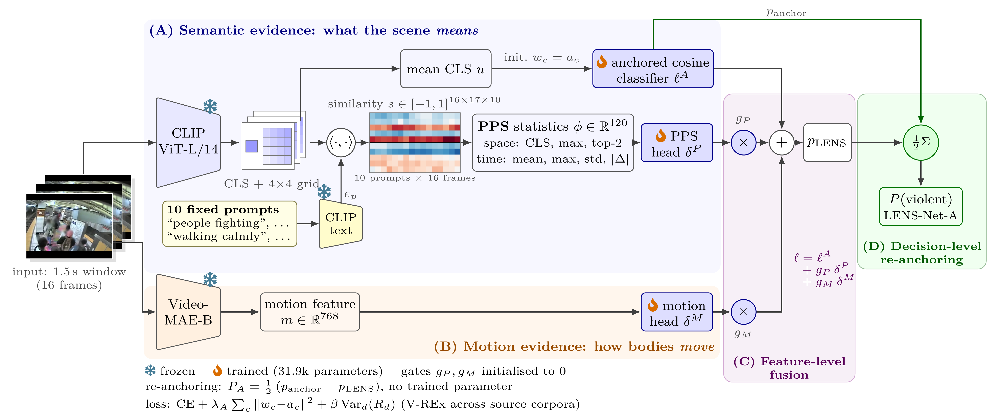
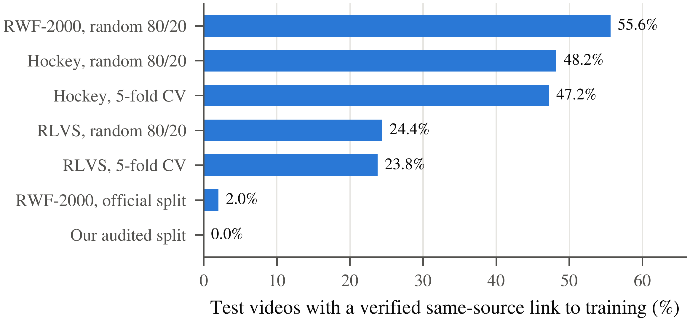
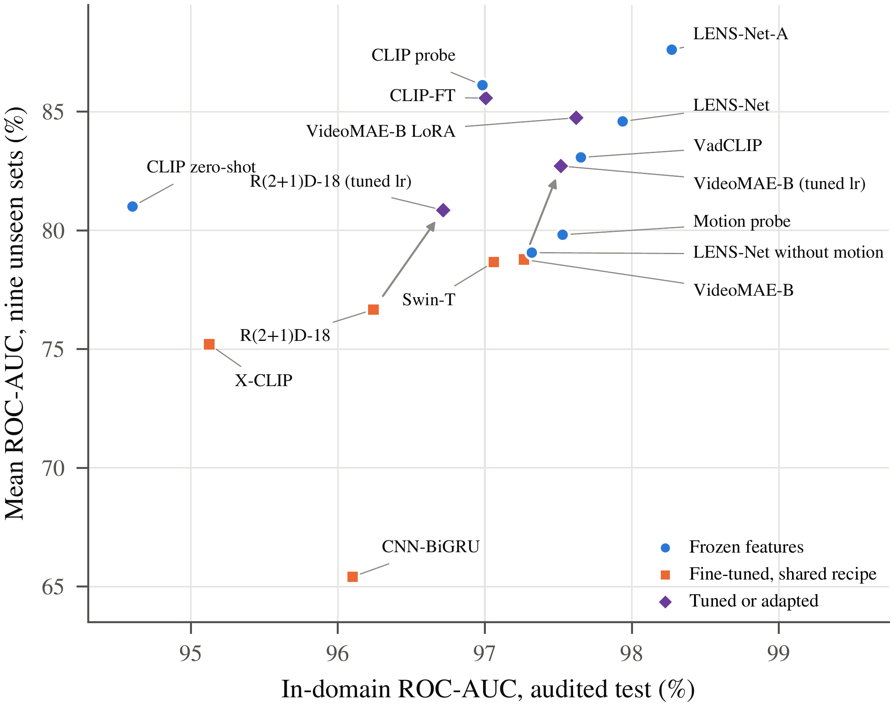
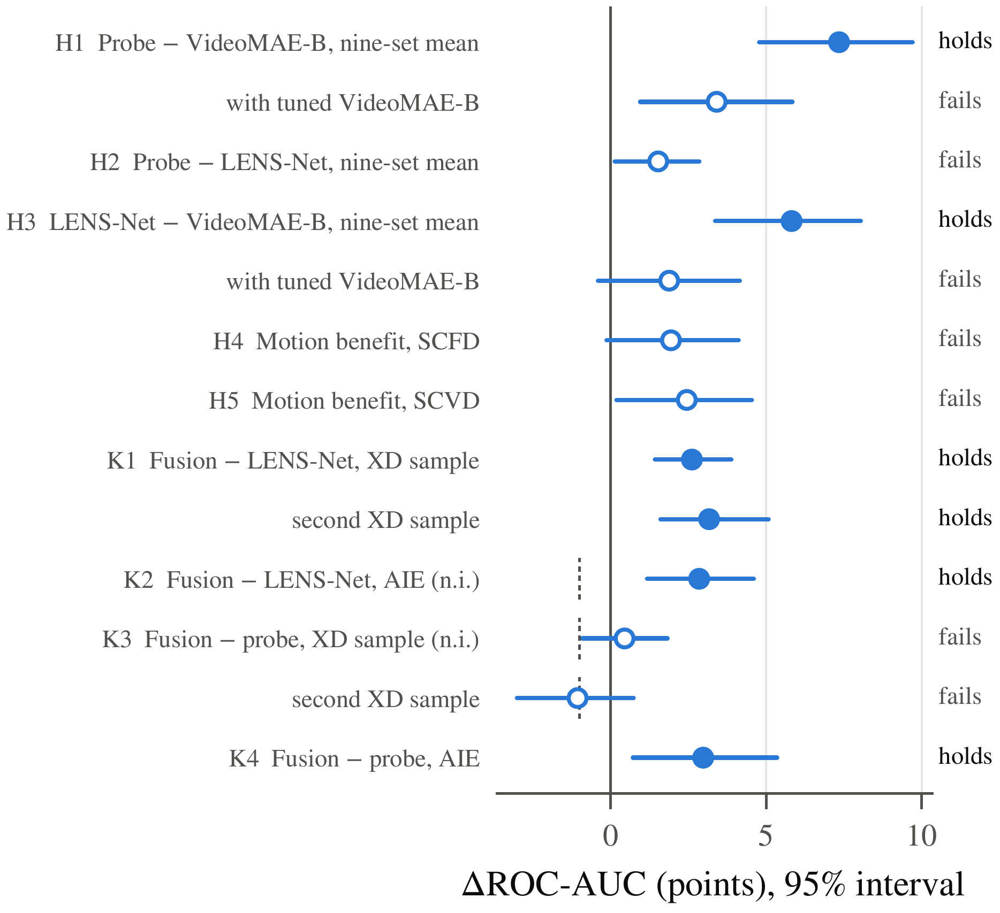
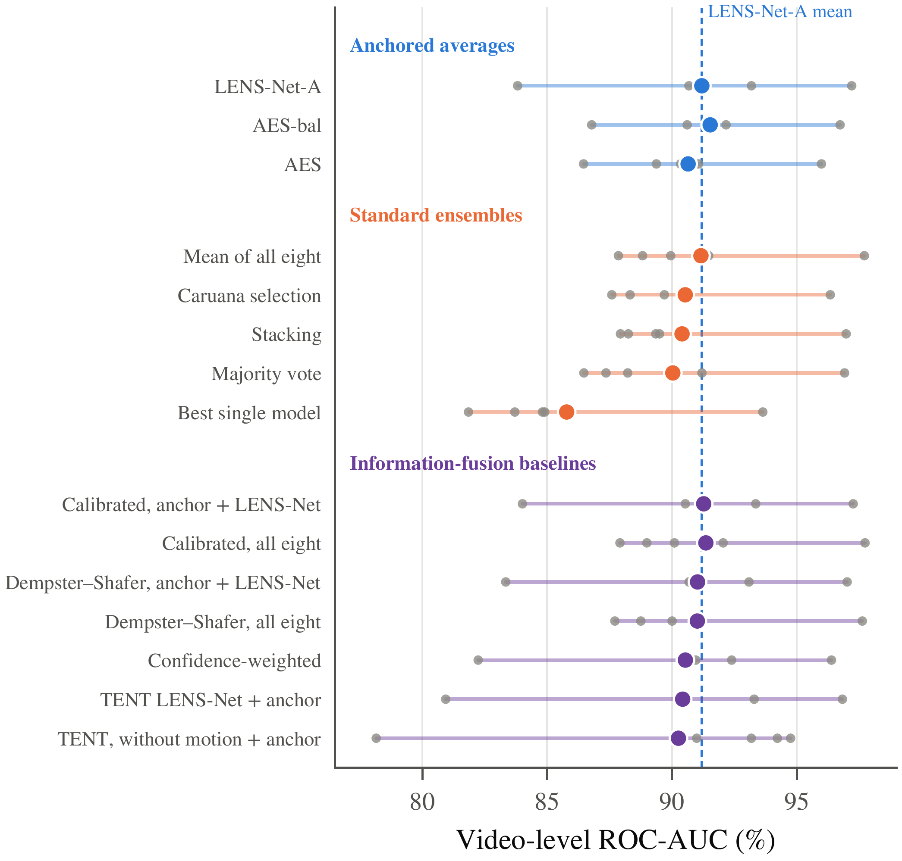
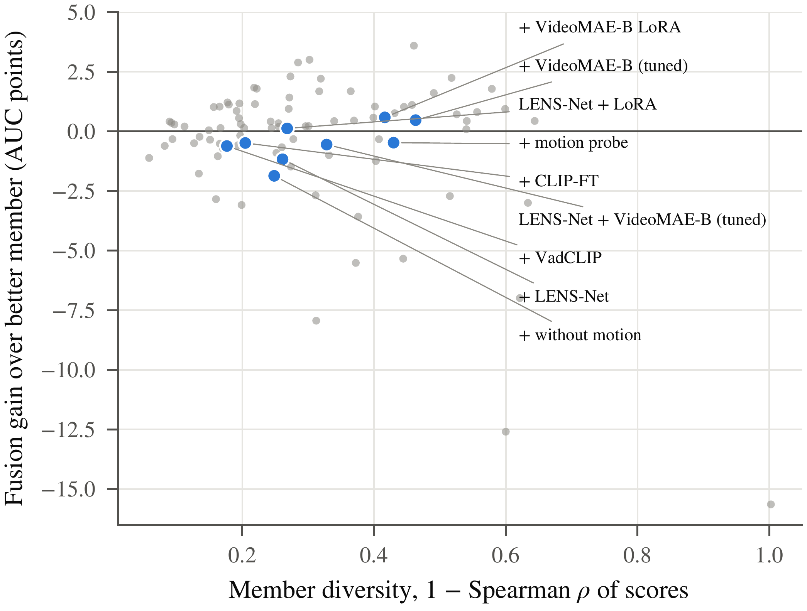

<div align="center">

# Fusing Language and Motion Evidence Under Domain Shift

### A Source-Controlled Study of Cross-Dataset Violence Detection

**Soma Samanta · Akhil Pratap Singh · Manju Khurana · Princy Randhawa · Jitendra Jaiswal · Shailendra Tiwari**

*Submitted to Information Fusion (Elsevier)*

[](https://github.com/shailendra-cloud/LENS-Net/actions/workflows/tests.yml)


[**Overview**](#-overview) · [**Results**](#-key-results) · [**Quick start**](#-quick-start) · [**Paper → code**](#-paper--code) · [**Data**](#-data) · [**Citation**](#-citation)

</div>

---

## 📌 Overview

Fusion weights are usually fitted on source data and then applied to data from new sources. This repository contains
the complete, scripted study that tests this setting in **cross-dataset violence detection**, with every source of
evidence switchable and every claim pre-registered.

| | Research question | Answer in one line |
|---|---|---|
| **RQ1** | How much do standard splits share sources between training and test data? | Under random 80/20 splits, **24.4–55.6%** of test videos in RLVS, Hockey Fights and RWF-2000 share a camera or scene with a training video. |
| **RQ2** | When does *feature-level* fusion of heterogeneous evidence transfer? | A frozen language-anchored CLIP classifier (**1.5k** trained parameters) transfers as well as the best tuned or LoRA-adapted video model; learned prompt-signal and motion corrections help on some datasets and hurt on others. |
| **RQ3** | Which *decision-level* fusion transfers, and why? | Averaging the full model with its anchor (**LENS-Net-A**) is the most robust confirmed rule. No rule with weights fitted on source data transferred significantly better, and on five untouched samples none of 23 other rules was consistently better. |

**LENS-Net** is the measurement instrument of the study, not a proposed detector. It keeps CLIP ViT-L/14 and VideoMAE-B frozen,
turns CLIP tokens into prompt-projected semantic signals (PPS), adds motion through gates that start at zero, and
penalises losses that differ between source corpora: **31,926 trained parameters**, about 1.5 min of CPU per run.

<p align="center"></p>
<p align="center"><sub><b>Fig. 2.</b> (A) semantic evidence, (B) motion evidence, (C) feature-level fusion with zero-initialised gates, (D) decision-level re-anchoring (LENS-Net-A).</sub></p>

## 📊 Key results

### RQ1: same-source overlap in standard splits

<p align="center"></p>

The audit was validated on 200 blind human-labelled pairs (all 59 sampled verified links judged same source; test–retest
κ = 0.92). Retraining four models on random and source-controlled splits did **not** significantly change in-domain AUC,
so the overlap changes *what* a test measures — generalisation to new clips of known sources — more than the number itself.

### RQ2: nine unseen test sets (Table 6)

Window-level ROC-AUC (%), mean of three seeds, trained once on the pooled source-controlled split of RLVS, RWF-2000,
Hockey Fights, Bus Violence and VID. **Bold** = best.

| Model | Trained params | XD | UCF | SCFD | SCVD | VioPeru | AIRTLab | CCTV-F | Movies | UBI | **Mean** | **Min** |
|---|---:|:-:|:-:|:-:|:-:|:-:|:-:|:-:|:-:|:-:|:-:|:-:|
| **LENS-Net-A** (anchor fusion, confirmed) | 33.5k | **90.42** | 77.67 | **96.93** | **91.89** | **83.68** | 82.11 | 83.85 | 89.88 | **92.03** | **87.61** | **77.67** |
| LENS-Net (instrument) | 31.9k | 85.11 | **77.99** | 96.88 | 90.87 | 83.46 | 78.54 | **85.32** | 74.68 | 88.44 | 84.59 | 74.68 |
| CLIP probe (anchor only) | 1.5k | 90.07 | 72.38 | 92.86 | 89.44 | 79.78 | **84.95** | 76.14 | **97.82** | 91.59 | 86.11 | 72.38 |
| Anchor + PPS (without motion) | 5.7k | 89.30 | 76.80 | 94.94 | 88.42 | 77.91 | 82.74 | 81.38 | 29.62 | 90.44 | 79.06 | 29.62 |
| Motion probe (motion only) | 26.2k | 79.27 | 75.70 | 95.24 | 88.08 | 79.05 | 71.25 | 83.34 | 62.24 | 84.18 | 79.82 | 62.24 |
| CLIP zero-shot | 0 | 84.03 | 69.46 | 91.53 | 86.25 | 72.76 | 81.74 | 72.63 | 84.45 | 86.19 | 81.01 | 69.46 |
| VadCLIP | 21.0M | 88.11 | 74.24 | 90.63 | 90.00 | 81.03 | 84.23 | 78.21 | 71.85 | 89.36 | 83.07 | 71.85 |
| X-CLIP FT | 126.9M | 79.73 | 61.98 | 86.94 | 80.72 | 68.23 | 70.34 | 72.93 | 69.86 | 86.10 | 75.20 | 61.98 |
| VideoMAE-B FT | 86.2M | 80.77 | 73.82 | 96.15 | 87.87 | 78.15 | 75.90 | 83.19 | 49.13 | 83.98 | 78.77 | 49.13 |
| Video Swin-T FT | 27.9M | 78.29 | 72.77 | 92.93 | 82.22 | 74.37 | 73.96 | 80.19 | 69.48 | 83.81 | 78.67 | 69.48 |
| R(2+1)D-18 FT | 31.3M | 76.84 | 69.35 | 92.12 | 85.07 | 72.14 | 70.96 | 80.49 | 64.71 | 78.32 | 76.67 | 64.71 |
| CNN-BiGRU | 6.1M | 76.74 | 52.46 | 83.60 | 78.30 | 62.40 | 68.84 | 68.79 | 16.56 | 81.02 | 65.41 | 16.56 |

Fine-tuned rows use one shared recipe. **Fair baselines change the picture** (Table 10): with a validation-selected
learning rate VideoMAE-B reaches 82.71 and with LoRA 84.74, so the CLIP probe (86.11) is *level* with the best adapted
video model rather than far ahead of it, and LENS-Net-A (87.61) remains the strongest.

<p align="center">


</p>
<p align="center"><sub><b>Left:</b> in-domain AUC (94.6–98.3 for every model) does not predict transfer (65.4–87.6). <b>Right:</b> the nine pre-registered primary claims with seed-aware 95% intervals; filled = holds after Holm correction.</sub></p>

### RQ3: decision-level fusion on five untouched samples

<p align="center">


</p>

- **Anchor fusion was confirmed** on untouched data: 3 of 4 pre-registered claims hold after Holm correction, and its
  gain over LENS-Net replicated on a second, disjoint sample.
- **Fitted weights did not transfer.** Validation-weighted averaging and stacking were never significantly better
  than the plain mean; the fitted weights shifted the vote towards the member adapted to the source corpora.
- **Nothing beat the anchored average consistently.** Anchored ensemble selection, standard ensembles, calibrated
  and Dempster–Shafer fusion, confidence weighting and test-time adaptation (TENT) were each significantly better on
  at most one of five untouched samples.
- **The gain follows accuracy balance more clearly than diversity** (ambiguity decomposition, Eq. 20).

## 🚀 Quick start

```bash
git clone https://github.com/shailendra-cloud/LENS-Net.git && cd LENS-Net
python3.9 -m venv venv && source venv/bin/activate
pip install -r requirements.txt
```

**1 · Unit tests — no data, under a minute.** Each test checks a statement of the paper (31,926 parameters, the
120-d PPS descriptor, Remark 1 on zero gates, Remark 2, the ambiguity decomposition, the AUC estimator).

```bash
pip install pytest && python -m pytest tests -q        # 11 passed
```

**2 · Reproduce the paper's numbers — about a minute.** Downloads the per-window predictions of every model
(97 MB, SHA-256 checked), recomputes the same-source overlap and all of Table 6, and checks the nine primary claims of
Table 9 against the stored bootstrap results.

```bash
bash reproduce/get_predictions.sh
python reproduce/verify_paper.py            # 201/201 values match the manuscript
python reproduce/verify_paper.py --full     # also re-runs the seed-aware cluster bootstrap behind Table 9 (about 30 min)
```

**3 · Re-run the study from the videos.** Download the datasets and prepare the frames as described in
[docs/DATA.md](docs/DATA.md), then run the eight numbered pipelines in order. The frames of the source corpora come
from the authors' curated collection, which is not distributed, so this step starts from the unseen sets for anyone
else. Feature extraction and the fine-tuned baselines need a GPU, and LENS-Net itself trains on a CPU.

```bash
bash tools/link_layout.sh
bash pipelines/01_features.sh   # ... through pipelines/08_revision.sh
```

Every script works from the clone itself, so no file needs editing. Leave `LENSNET_ROOT` unset: the scripts under
`src/` honour it, but the `video_data` utilities and the table and figure generators always use the clone.

## 🧭 Paper → code

| Paper | What | Code | Output |
|---|---|---|---|
| §3.2, §4, Fig. 3, Table 8c | same-source overlap under public splits | `src/audit/audit_public_splits.py` | `results/public_split_audit.json` |
| §3.2, §4.3, Table 5 | human validation of the audit | `src/revision/make_audit_label_sample.py`, `analyze_audit_labels.py` | `results/revision/d1_labels_final.json` |
| §3.5, Eqs. 5–15, Alg. 1 | LENS-Net, its components and gates | `src/model/lensnet.py`, `src/model/lensnet_setup.py` | `workspace/runs/` |
| §3.5.1 | frozen CLIP and VideoMAE-B features | `src/features/extract_compact.py`, `extract_vmae.py` | `workspace/features/` |
| §3.5.7, Eq. 16 | LENS-Net-A (anchor fusion) | `src/datasets/confirm_anchor_fusion.py`, `src/evaluation/anchor_fusion_dev.py` | `results/conf3_results.json` |
| §3.6 | fine-tuned baselines, VadCLIP, X-CLIP | `src/baselines/train_video_baseline.py`, `vadclip_run.py`, `xclip_zs.py` | `workspace/runs_baselines/` |
| §3.7, Eqs. 22–26 | seed-aware cluster bootstrap, Holm | `src/revision/seed_aware_bootstrap.py` | `results/revision/stats.json` |
| §4.1, Table 4 | random vs source-controlled splits | `src/revision/make_random_vs_source_splits.py`, `analyze_random_vs_source_splits.py` | `results/revision/c1_results.json` |
| §4.2, §5.4, Table 13 | test-side filter, stricter filter, ambiguous windows | `src/revision/analyze_test_filter.py`, `analyze_stricter_filter.py`, `analyze_ambiguous_windows.py` | `results/revision/filtering.json`, `c7_filter090.json`, `e4_amb.json` |
| §5.1, Tables 6–7, 9 | main results and primary claims | `src/evaluation/analyze_clip_methods.py`, `src/revision/seed_aware_bootstrap.py` | `results/clip_methods_results.json` |
| §5.2, Table 10 | learning-rate search, LoRA, CLIP-FT | `src/revision/train_finetuned_on_split.py`, `train_clip_ft.py`, `analyze_fair_baselines.py` | `results/revision/c45.json`, `e1_clipft.json` |
| §5.3–5.4, Tables 11–12 | OpenCLIP (LAION-2B), IRM, GroupDRO, V-REx, hyperparameters | `src/revision/analyze_laion_control.py`, `analyze_dg_objectives.py`, `analyze_hyperparameters_and_motion_dg.py` | `results/revision/c2_laion.json`, `c3_dg.json`, `e23.json` |
| §5.6, Table 8 | single-source (P3), leave-one-out (P2), standard splits (P4) | `src/evaluation/analyze_main.py`, `analyze_baselines_rwf.py`, `src/datasets/make_standard_splits.py` | `results/A2_results.json` (8a), `stageF_results.json` (8b) |
| §5.7–5.8 | SCFD, SCVD, VioPeru, AIRTLab, CCTV-Fights | `src/datasets/build_*.py`, `src/evaluation/score_*.py`, `analyze_*.py` | `results/fresh_results.json`, `conf_results.json`, `cfights_results.json` |
| §5.9, Table 14 | frame-level protocol, XD-Violence and UCF-Crime | `src/datasets/framelevel_xd_ucf.py`, `src/evaluation/analyze_framelevel_xd_ucf.py` | `results/framelevel_results.json` |
| §5.10, Fig. 6 | transfer from RWF-2000 | `src/evaluation/analyze_baselines_rwf.py`, `paper/make_figures.py` | `results/A2_results.json` |
| §5.11 | comparison with VadCLIP and X-CLIP | `src/baselines/vadclip_run.py`, `xclip_zs.py`, `src/evaluation/analyze_clip_methods.py` | `results/clip_methods_results.json` |
| §5.12, Table 15 | ablations, motion gates, efficient variants, prompt sets | `src/model/lensnet.py` (configs `V2a`, `-G`, `-T`, `-Sp`, `LENS-AG`, `LENS-FG`), `src/evaluation/analyze_main.py`, `score_footage_gate_dev.py` | `results/stageF_results.json`, `fg_dev_window.json` |
| §5.13 | ten seeds | `src/revision/score_extra_seeds.py`, `ten_seed_analysis.py` | `results/revision/ten_seeds.json` |
| §6.1, §8.1–8.2 | LENS-AG and LENS-FG gates | `src/model/lensnet.py` (`LENS-AG`, `LENS-FG`), `src/datasets/confirm_footage_gate.py` | `results/stageF_results.json`, `conf2_results.json` |
| §6.2, Table 16 | anchor-fusion confirmation, second sample, symmetric control | `src/datasets/confirm_anchor_fusion.py`, `src/revision/confirm_anchor_fusion_sample_b.py`, `src/evaluation/ensemble_control.py` | `results/conf3_results.json`, `results/revision/c6_confirmB.json` |
| §6.3, Table 17 | eight fusion rules on nine member pairs | `src/revision/compare_fusion_rules.py` | `results/revision/e5_fusion.json` |
| §6.4, Fig. 7 | member diversity vs fusion gain | `src/revision/analyze_member_diversity.py` | `results/revision/e6_diversity.json` |
| §6.5, Table 18 | anchored ensemble selection: search, confirmation, diagnosis | `src/revision/explore_anchored_selection.py`, `score_aes_confirmation.py`, `analyze_aes_confirmation.py`, `analyze_aes_diagnosis.py` | `results/revision/f_aes_*.json` |
| §6.5 (not pursued) | label-free weighting, co-adaptation, fusion-aware partner | `src/revision/explore_*.py` | `results/revision/explore_*.json` |
| §6.6–6.7, Tables 19–20, Figs. 8–9 | 24 fusion rules on five untouched samples | `src/revision/confirm_fusion_rules_untouched.py`, `analyze_fusion_rules_untouched.py`, `analyze_fusion_baselines_untouched.py`, `analyze_anchor_complementarity.py` | `results/revision/g_partG.json`, `h_partH.json`, `i_partI.json` |
| §7.1, Fig. 10, Table 21 | prompt sets and prompt sensitivity | `src/model/lensnet_setup.py` (`PROMPT_SETS`), `paper/fig_prompts.py` | `results/fig_prompts_values.json` |
| §7.2–7.3, Figs. 11–12 | error analysis, robustness to corruptions | `src/evaluation/error_analysis.py`, `robustness.py`, `analyze_robust.py` | `results/error_analysis.json`, `robust_results.json` |
| §7.4–7.5, Figs. 13–17 | evidence maps, PPS signals, stream contributions, t-SNE, qualitative results | `paper/fig_evidence.py`, `make_figures.py`, `tsne_fig.py`, `make_qualitative.py`, `plot_qualitative.py` | figures |
| §8.3, Fig. 18 | efficient variants, latency, GFLOPs | `src/evaluation/efficiency_*.py`, `latency.py` | `results/efficiency*.json`, `latency.json` |
| §8.4 | LENS-FT (in-domain fine-tuning) | `src/model/cache_clip_block20.py`, `lensnet_ft.py` | `workspace/runs_ft/` |
| All result tables and plots | generated from the result files, never typed by hand | `paper/make_tables.py`, `src/revision/make_revision_macros*.py`, `paper/make_figures.py`, `paper/fig_*.py` | `paper/tables/`, `paper/numbers.tex`, `review_numbers.tex`, `revision_c_numbers.tex`, figures |

<details>
<summary><b>Repository layout</b></summary>

```
LENS-Net/
├── src/
│   ├── model/        LENS-Net, its components and gates; LENS-FT
│   ├── features/     frozen CLIP ViT-L/14 and VideoMAE-B feature extraction
│   ├── audit/        same-source overlap under public splits (RQ1) and its protocol
│   ├── datasets/     building, filtering and scoring the unseen and untouched test sets
│   ├── baselines/    fine-tuned video models, VadCLIP, X-CLIP
│   ├── evaluation/   scoring, statistics, robustness, error analysis, cost
│   └── revision/     controls, fair baselines, seed-aware statistics, fusion-rule studies
├── video_data/       windowing, frame store, same-source detection, CNN-BiGRU baseline
├── pipelines/        01–08: the whole study, in order (stage 4 extracts the features of the sets it builds)
├── reproduce/        get_predictions.sh, verify_paper.py
├── tests/            unit tests (no data needed), run by GitHub Actions
├── data_tables/      every window used: splits, same-source components, unseen and untouched sets
├── results/          the JSON summaries every number in the paper is generated from (index: results/README.md)
├── prereg/           pre-registrations, deviations, checksums and OpenTimestamps proofs
├── paper/            table and figure generators
└── docs/             dataset sources, README figures
```
</details>

<details>
<summary><b>Scripts outside the numbered pipelines</b></summary>

| Script | Role |
|---|---|
| `video_data/build_source_manifest.py`, `audit_source_manifest.py`, `check_near_duplicates.py` | built and audited the source manifest and the same-source edges in `data_tables/`. They read files of the earlier data curation that are not distributed ([docs/DATA.md](docs/DATA.md)). |
| `video_data/build_external_windows.py`, `build_frame_store.py`, `build_lodo_splits.py` | windows of the XD-Violence and UCF-Crime test sets, frame store of the source windows, leave-one-dataset-out manifests (the `lodo:` splits) |
| `video_data/train_cnn_bigru.py`, `evaluate_cnn_bigru.py` | the CNN-BiGRU baseline |
| `src/features/extract_clip_tokens.py`, `make_compact.py` | token-level CLIP features and their compact form, read by `lensnet_setup.py` and `lensnet_ft.py` |
| `src/evaluation/pilot_decision.py`, `select_design.py` | pre-registered pilot gate and design selection (§3.8) |
| `src/revision/render_audit_label_pairs.py` | images of the pairs shown to the labeller in the human validation of the audit |
| `paper/make_arch_assets.py`, `fig_graphical_abstract.py` | frames of the architecture figure, graphical abstract |
</details>

## 🧪 Research practice

- **Source-controlled splits.** Windows linked by a verified same-source match form components, and whole components
  are assigned to one split, so no verified link crosses training and test (columns `split` and `component_id` of
  `data_tables/manifests/source_windows.csv`; `data_tables/splits/` holds the public-style splits used for comparison).
- **Pre-registered.** Every confirmatory stage was fixed in a dated, checksummed plan before its runs; each plan
  carries an [OpenTimestamps](https://opentimestamps.org) proof anchored in the Bitcoin blockchain
  (`prereg/revision_timestamped/`, verification steps in `VERIFY_TIMESTAMPS.txt`). Deviations are listed in the plans.
- **Statistics.** Seed-aware hierarchical cluster bootstrap (2,000 resamples) with Holm–Bonferroni correction over
  the nine primary claims; every other comparison is labelled descriptive.
- **Untouched data.** Confirmation samples were scored once, after the design under test had been fixed.
- **Privacy.** Heads are blurred in every figure that shows people. The audit's unblinding key
  (`results/revision/label_key_HIDDEN.csv`) was hidden from the labeller during labelling and is released for
  analysis.

## 💾 Data

No video, frame or feature file is distributed; dataset licences forbid it. Download each dataset from its source
(**[docs/DATA.md](docs/DATA.md)**). The window manifests in `data_tables/` identify every window used.

| Role | Datasets |
|---|---|
| Source corpora (training) | RLVS · RWF-2000 · Hockey Fights · Bus Violence · VID |
| Development (unseen) | XD-Violence · UCF-Crime |
| Fresh (motion stream) | SCFD · SCVD |
| Untouched | VioPeru · AIRTLab · CCTV-Fights · Movies · UBI-Fights |
| Fusion-rule confirmation | XD-Violence training samples A and B · AIE · UCF-Crime training subset · HMDB51 interaction classes |

The per-window predictions of every model are released as `lensnet_predictions.tar.xz`
(SHA-256 `b48a4552…8bc1582d`), fetched by `reproduce/get_predictions.sh`.

## 📄 Citation

```bibtex
@unpublished{samanta2026fusing,
  title  = {Fusing Language and Motion Evidence Under Domain Shift: A Source-Controlled Study of
            Cross-Dataset Violence Detection},
  author = {Samanta, Soma and Singh, Akhil Pratap and Khurana, Manju and Randhawa, Princy and Jaiswal, Jitendra and
            Tiwari, Shailendra},
  note   = {Submitted to Information Fusion. Code: https://github.com/shailendra-cloud/LENS-Net},
  year   = {2026}
}
```

## 🙏 Acknowledgements

LENS-Net builds on [OpenAI CLIP](https://github.com/openai/CLIP), [OpenCLIP](https://github.com/mlfoundations/open_clip)
and [VideoMAE](https://github.com/MCG-NJU/VideoMAE), and compares with [VadCLIP](https://github.com/nwpu-zxr/VadCLIP)
and [X-CLIP](https://github.com/microsoft/VideoX/tree/master/X-CLIP). We thank the authors of every dataset listed above.

## 🌍 Responsible use

Violence detection is dual-use. Our results show that accuracy on new cameras can be markedly lower than on benchmark
tests. A deployed detector should be evaluated on footage from its own cameras, operated under applicable law, and
used to support, not replace, human judgement.
